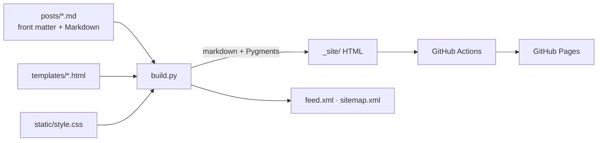

<!-- topics: blog, engineering, software-architecture, python, fastapi, distributed-systems, rag, ai-agents, technical-writing -->
# Engineering Notes

Deep-dive articles on the design decisions, trade-offs and tests behind my open-source backend projects.

[](https://github.com/AkibUllah/engineering-notes/actions/workflows/pages.yml)


**Read it at https://akibullah.github.io/engineering-notes/** (RSS: [`feed.xml`](https://akibullah.github.io/engineering-notes/feed.xml))

Each article takes one project and explains how one hard part of it works, with real code excerpts linked to the source, a diagram where it helps, the tests that back the claims, the limits I know about, and what I'd build next.

## Articles

| Article | Project | Topics |
| --- | --- | --- |
| [Running webhook workers in parallel without double delivery](https://akibullah.github.io/engineering-notes/posts/parallel-webhook-workers-skip-locked/) | [webhook-relay](https://github.com/AkibUllah/webhook-relay) | `FOR UPDATE SKIP LOCKED`, claim leases, crash recovery, at-least-once |
| [Measuring retrieval instead of guessing](https://akibullah.github.io/engineering-notes/posts/measuring-rag-retrieval/) | [rag-eval-lab](https://github.com/AkibUllah/rag-eval-lab) | chunkers vs retrievers, evidence spans, Bangla tokenisation |
| [Guardrails that don't trust the model](https://akibullah.github.io/engineering-notes/posts/guardrails-that-dont-trust-the-model/) | [ai-support-agent](https://github.com/AkibUllah/ai-support-agent) | session-bound auth, policy engine, injection screening, ablation |
| [Five rate-limiting algorithms, one Lua script each](https://akibullah.github.io/engineering-notes/posts/five-rate-limiting-algorithms/) | [rate-limiter-service](https://github.com/AkibUllah/rate-limiter-service) | token bucket, windows, GCRA, Redis Lua atomicity, benchmarks |
| [Refresh-token rotation with reuse detection, and tenancy in one dependency](https://akibullah.github.io/engineering-notes/posts/refresh-token-rotation-tenant-isolation/) | [multi-tenant-saas-auth](https://github.com/AkibUllah/multi-tenant-saas-auth) | token families, reuse detection, tenant resolution, RBAC |
| [Idempotency keys done properly in a payment API](https://akibullah.github.io/engineering-notes/posts/idempotency-keys-payment-gateway/) | [fastapi-payment-gateway](https://github.com/AkibUllah/fastapi-payment-gateway) | idempotent replay, payment state machine, money in minor units |

## How the site is built



- `build.py` (under 400 lines, two dependencies: `markdown` and `pygments`) turns each post into `_site/posts/<slug>/index.html`, highlights code at build time, and writes the index, `feed.xml` (RSS 2.0), `sitemap.xml` and `404.html`.
- Mermaid fences are left for the client. Pages with a diagram load Mermaid from the jsDelivr CDN, and pages without one load no JavaScript at all.
- Light and dark themes follow `prefers-color-scheme`, with separate Pygments palettes for each.
- `.github/workflows/pages.yml` builds on every push to `main` and deploys with `actions/deploy-pages`. Pull requests are built but not deployed.

## Build locally

```bash
git clone https://github.com/AkibUllah/engineering-notes.git
cd engineering-notes
make install          # python3 -m venv .venv && pip install -r requirements.txt
make serve            # builds, then serves http://127.0.0.1:8080/engineering-notes/
```

`make build` only writes `_site/`. The base path and absolute URL come from `BASE_PATH` (default `/engineering-notes/`) and `SITE_URL` (default `https://akibullah.github.io/engineering-notes/`), so a fork can publish elsewhere without editing code.

## Writing a post

Add `posts/YYYY-MM-DD-slug.md`:

```markdown
---
title: A short, specific title
date: 2026-10-25
summary: One sentence for the index and the RSS feed.
tags: postgresql, python
repo: webhook-relay
---

Body in Markdown. Fenced code is highlighted; ```mermaid fences become diagrams.
A line `{: .file }` under a paragraph styles it as a file caption for the next code block.
```

## Project structure

```
build.py                    # Markdown -> HTML, feed, sitemap, local server
posts/                      # one Markdown file per article
templates/                  # base, index, post and Mermaid snippets (string.Template)
static/                     # style.css, favicon.svg
.github/workflows/pages.yml # build and deploy to GitHub Pages
```

## License

The site code (build script, templates, styles, workflow) is MIT licensed, see [LICENSE](LICENSE).

The article text in `posts/` is © 2026 Akib Jafor and licensed under [CC BY 4.0](https://creativecommons.org/licenses/by/4.0/). You may share and adapt it with attribution. Code excerpts quoted from other repositories keep those repositories' MIT licenses.
