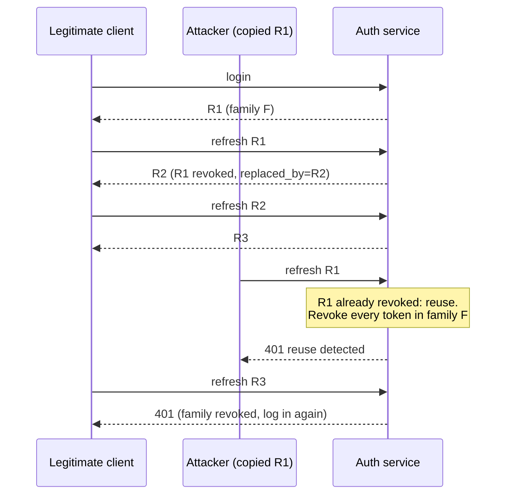

Every B2B product I have worked on, from merchant back-offices to cloud customer portals, ended up rebuilding the same auth core. Users belong to several organizations with a different role in each. Sessions need revoking when a laptop is lost. Integrations need API keys. And in every code review someone asks: "did we remember to filter this query by tenant?"

[multi-tenant-saas-auth](https://github.com/AkibUllah/multi-tenant-saas-auth) is that core extracted into one service. This post covers its two most interesting mechanisms: refresh-token rotation with reuse detection, and tenant resolution that happens in exactly one place.

## Two tokens, two jobs

A login returns two things:

- an **access token**: a JWT signed with HS256 that lives 15 minutes (`ACCESS_TOKEN_TTL_SECONDS=900`). It is checked on every request without a database lookup for the session.
- a **refresh token**: an opaque, URL-safe random string with 48 bytes of entropy that lives 30 days. It can only be used at `/v1/auth/refresh`.

The server stores only the SHA-256 of each refresh token. bcrypt would be the wrong tool here, since slow hashing exists to protect *guessable* secrets, and a 48-byte random token isn't guessable. A fast digest is enough, and a leaked `refresh_tokens` table contains nothing anyone can present.

## Rotation in families

Every refresh revokes the presented token and issues a new one. That alone would only limit how long a stolen token stays useful. The interesting part is what happens when an *old* token comes back.

Each login starts a **family**. Every token issued by refreshing inherits the family ID and records which token it replaced. A legitimate client only ever holds the newest token in its family. So if a token that was *already rotated* is presented again, two parties have a copy of the chain, and the server can't tell which one is the owner. It revokes the whole family:



The code for that branch is short, and one line in it is easy to miss:

`src/saas_auth/tokens.py` ([source](https://github.com/AkibUllah/multi-tenant-saas-auth/blob/main/src/saas_auth/tokens.py))
{: .file }

```python
if record.revoked_at is not None:
    revoked = revoke_family(db, record.family_id)
    db.commit()
    log.warning(
        "refresh token reuse detected user=%s family=%s revoked=%d",
        record.user_id,
        record.family_id,
        revoked,
    )
    raise RefreshTokenReused("refresh token reuse detected; session family revoked")
```

The `db.commit()` before the `raise` is important. The route turns the exception into a `401`, and the request-scoped session is closed without committing. Without that explicit commit, the family revocation would be thrown away together with the failed request, and the attacker could simply try again. An error path that has to *persist* something needs its own commit.

The test walks through the attack:

`tests/test_tokens.py` ([source](https://github.com/AkibUllah/multi-tenant-saas-auth/blob/main/tests/test_tokens.py))
{: .file }

```python
t1 = api.signup("reuse@example.com")
t2 = _refresh(client, t1["refresh_token"]).json()
t3 = _refresh(client, t2["refresh_token"]).json()

# Attacker replays t1 (already rotated) -> reuse detected.
r = _refresh(client, t1["refresh_token"])
assert r.status_code == 401
assert "reuse" in r.json()["detail"]

# The legitimate latest token (t3) is now dead as well.
r = _refresh(client, t3["refresh_token"])
assert r.status_code == 401
```

It then checks the database directly: three rows, one family, all revoked.

**Why families, rather than revoking everything for the user?** A separate test logs in on two "devices", replays a rotated token from device A, and asserts that device B can still refresh. A stolen phone logs out the phone's session, not the user's laptop. If the user wants everything gone, `/v1/auth/logout-all` exists, and password reset and password change call it automatically.

## What rotation doesn't solve

Being explicit about the gaps:

- **Access tokens outlive revocation.** After a family is revoked, an access token already issued from it stays valid until it expires, up to 15 minutes. `get_principal` checks that the user exists and is active, not that the session is alive. The short TTL is the mitigation. A per-request session check would close the gap at the cost of a lookup on every call.
- **Concurrent refreshes can look like theft.** Two browser tabs that refresh with the same token at nearly the same moment: the second request finds the token already rotated and revokes the family, so a legitimate user gets logged out. If they arrive truly at the same time, both can pass the `revoked_at` check, because the row isn't locked, and the family forks. The usual fixes are a short grace window for the immediately previous token, or `SELECT ... FOR UPDATE` on the token row. Neither is in place yet. Clients should serialise refreshes, which most HTTP interceptors already do.

## Tenancy in one dependency

The second problem is the forgotten `WHERE org_id = ?`. The service routes every organization-scoped endpoint through a single dependency, `resolve_tenant`, wrapped by `require(...)`:

`src/saas_auth/rbac.py` ([source](https://github.com/AkibUllah/multi-tenant-saas-auth/blob/main/src/saas_auth/rbac.py))
{: .file }

```python
org = db.get(Organization, org_id)
if org is None:
    raise HTTPException(status.HTTP_404_NOT_FOUND, "Organization not found")

if principal.api_key is not None:
    key = principal.api_key
    if key.org_id != org.id:
        raise HTTPException(status.HTTP_404_NOT_FOUND, "Organization not found")
    ...
    return TenantContext(org=org, principal=principal, permissions=frozenset(key.scopes))

assert principal.user is not None
membership = get_membership(db, principal.user.id, org.id)
if membership is None:
    raise HTTPException(status.HTTP_404_NOT_FOUND, "Organization not found")
return TenantContext(
    org=org,
    principal=principal,
    permissions=permissions_for(membership.role),
    role=membership.role,
)
```

A route declares what it needs and receives a resolved context:

```python
def create_project(
    payload: ProjectCreate,
    ctx: TenantContext = Depends(require("projects:create")),
    db: Session = Depends(get_db),
) -> Project:
```

A few details make this hold up in practice:

- **Non-members get 404, not 403.** A `403` would confirm that the organization exists, which lets anyone enumerate IDs. Each of the three failure cases (no such org, not a member, API key from another org) gives the same answer.
- **One permission vocabulary for people and machines.** Roles map to flat strings such as `projects:create` and `members:invite`, and API key scopes use the same strings. `require("projects:create")` works the same for a member's JWT and an integration's `X-API-Key`. A key can't be created with scopes its creator doesn't hold.
- **Typos fail at startup.** `require()` checks its arguments against the permission map when the module loads. A misspelled permission raises `ValueError` before the app serves a single request, instead of silently denying (or allowing) at runtime.
- **Roles are per organization.** The same user can be owner of one org and viewer of another, and a test checks exactly that.

## The dependency is a choke point, not a force field

There is a limit here that I want to state precisely. `resolve_tenant` guarantees that the caller is allowed to act *in organization X*. It doesn't rewrite queries. The handler still has to say `WHERE org_id = X`:

`src/saas_auth/routers/projects.py` ([source](https://github.com/AkibUllah/multi-tenant-saas-auth/blob/main/src/saas_auth/routers/projects.py))
{: .file }

```python
def _get_project(db: Session, org_id: str, project_id: str) -> Project:
    project = db.scalar(select(Project).where(Project.id == project_id, Project.org_id == org_id))
```

That is why the isolation suite contains a test that would look redundant if the dependency did everything: Alice uses *her own* org ID, where she is a legitimate member, together with *Bob's* project ID, and `GET`, `PATCH` and `DELETE` must all return 404. That test protects the handler filter, not the dependency. For a larger codebase I'd want the filter enforced below the handlers too, through a tenant-scoped session or PostgreSQL row-level security. Here, one helper per resource plus that test is the guarantee.

One more trade-off. API key scopes are checked against the creator's permissions *when the key is created*. Demoting or removing the creator doesn't shrink or revoke their keys later. Keys stay valid until an admin revokes them, which suits integrations but should be visible to whoever manages the org. That is one reason a security audit log is on the roadmap.

## What I'd do next

From the repository's roadmap:

- **Alembic migrations.** Tables are created with `create_all` at startup today.
- **Optional TOTP second factor and WebAuthn passkeys.**
- **An audit log of security events** (role changes, key creation, lockouts, reuse detections) with an export endpoint. Reuse detection currently only logs a warning.
- **OAuth2 / OIDC login** (Google, GitHub), mapped onto the same user and membership model so `require(...)` doesn't change.
- **Sliding-window rate limiting and per-organization quotas**, replacing the fixed-window limiter on the auth endpoints.

Most of the work here was deciding what *one* place gets to decide: one function rotates tokens, one dependency resolves the tenant, one map defines permissions. The tests check that those single places are the only ones that matter.
