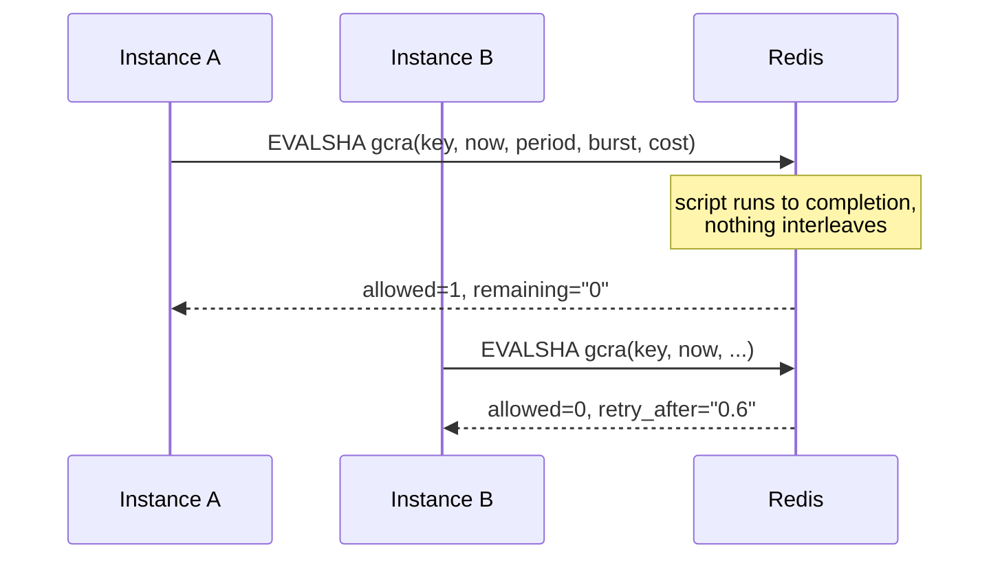

Every rate limiter I have inherited started as a dictionary in one process. The second version moves the dictionary to Redis and runs `GET`, compares, then `SET`. That works in testing and fails under load: two instances read "99 of 100 used" at the same moment, both allow the request, and the limit quietly becomes a suggestion.

[rate-limiter-service](https://github.com/AkibUllah/rate-limiter-service) is the version I want to start from next time. It implements five algorithms behind one `Policy` type, over an in-memory backend and a Redis backend that runs each algorithm as a single Lua script. It can be used as a library, as ASGI middleware, or as a small HTTP service. This post compares the algorithms, explains the atomicity design, and goes through the benchmark numbers in the README.

## Two choices that shape everything

**Algorithms live in the backend, dispatch lives in the limiter.** Each backend implements five primitive operations that take `now` and return `(allowed, remaining, retry_after, reset_after)`. The Python and Lua versions follow the same steps line for line, and the same algorithm test suite runs against both (Redis through `fakeredis[lua]`).

**Time is a parameter.** The limiter reads one clock and passes the timestamp into the backend, and Redis never calls `TIME`. Tests use a `ManualClock` and advance it, so "wait 60 seconds and try again" runs in microseconds. The trade-off is that instances need reasonably synchronised clocks. If two instances disagree by a second, a window edge can land a second differently for each of them. On NTP-synced hosts that is noise next to a 60-second window, and it buys fully deterministic tests. Under a 1-second window I would reconsider.



## The five algorithms

| Algorithm | State per key | Boundary behaviour | Best for |
| --- | --- | --- | --- |
| `fixed_window` | one counter | allows up to 2x `limit` across a window edge | cheap quotas, coarse limits |
| `sliding_log` | sorted set of timestamps | exact | small limits that must be precise (login, OTP) |
| `sliding_counter` | current + previous counters | near-exact (weighted estimate) | general API limits |
| `token_bucket` | tokens + last refill | smooth; `burst` controls spikes | public APIs that should allow short bursts |
| `gcra` | one timestamp (TAT) | exact spacing with `burst` allowance | high-rate limits where memory matters |

**Fixed window** counts requests in aligned buckets: `floor(now / window) * window`. It is the cheapest option, with one integer per key, and it has a known flaw that the test suite pins down rather than hides:

`tests/test_algorithms.py` ([source](https://github.com/AkibUllah/rate-limiter-service/blob/main/tests/test_algorithms.py))
{: .file }

```python
policy = Policy(limit=2, window=10, algorithm=Algorithm.FIXED_WINDOW)
clock.set(1_700_000_008.0)  # 8s into the window
burst(limiter, "k", policy, 2)
denied = limiter.check("k", policy)
assert not denied.allowed and denied.retry_after == pytest.approx(2.0)
clock.advance(2.0)  # new aligned window -> the classic 2x burst at the boundary
assert all(d.allowed for d in burst(limiter, "k", policy, 2))
```

Four requests in two seconds under a "2 per 10 seconds" policy. For a monthly quota that doesn't matter. For an OTP endpoint it does.

**Sliding log** stores a timestamp per accepted request in a Redis sorted set, drops anything older than the window, and counts what remains. It is exact, and its memory grows with the limit, which is why I only use it for small limits. The demo seeds an `otp` policy of 5 per 5 minutes. Each member gets a random nonce suffix, so two requests with the same timestamp don't overwrite each other in the set.

**Sliding window counter** keeps only the current and previous fixed-window counts and estimates the sliding total as `previous × (1 − elapsed) + current`. Halfway through a window, the previous window counts at 50%. The test shows the effect: after 10 requests fill one window, exactly 5 more are allowed at the halfway point of the next. It also predicts `retry_after` by solving for the moment the estimate drops enough, instead of just returning "end of window".

**Token bucket** has a capacity of `burst` (which defaults to `limit`) and refills at `limit / window` tokens per second. It allows short spikes and smooths sustained traffic, which suits public APIs.

**GCRA** (generic cell rate algorithm) stores a single number per key, the theoretical arrival time, and gives the same result as a token bucket with exact spacing. This is the whole Redis implementation:

`src/ratelimiter/backends/redis.py` ([source](https://github.com/AkibUllah/rate-limiter-service/blob/main/src/ratelimiter/backends/redis.py))
{: .file }

```lua
local tat = tonumber(redis.call('GET', KEYS[1]))
if tat == nil or tat < now then tat = now end
local new_tat = tat + period * cost
local allow_at = new_tat - burst * period
local allowed = 0
if allow_at <= now + 1e-9 then
  allowed = 1
  redis.call('SET', KEYS[1], tostring(new_tat), 'PX', math.ceil((new_tat - now) * 1000) + 1000)
  tat = new_tat
end
```

One `GET`, one `SET`, a TTL that expires the key exactly when it stops mattering, and no counters to reset. When memory per key matters at high request rates, this is the one I would choose.

## Atomicity, and two Lua details

Redis runs a script to completion before serving any other command, so the read-decide-write sequence inside it can't interleave with another instance. That is the entire concurrency story: no `WATCH`/`MULTI` retries and no distributed locks. Scripts are registered once and called with `EVALSHA`.

Two Lua details are easy to get wrong, and the code handles both:

- **Lua numbers are truncated to integers in Redis replies.** A `retry_after` of `0.6` comes back as `0`. Every script returns its floats as `tostring(...)` and the Python side parses them.
- **Denied requests don't write.** In every script the state change sits inside the `allowed` branch. A client that keeps retrying while limited isn't pushed further into the future, and `retry_after` tells it exactly when the next unit frees up. The suite checks "denied requests do not consume quota" for every algorithm on both backends.

## Reading the benchmark

`bench/bench.py` runs 200,000 checks spread round-robin over 1,000 keys under a `100/60s` policy, with the manual clock advancing 0.5 ms per check. These are the numbers in the README, from one run on a shared 4-core x86_64 machine with Python 3.10.12, in-memory backend:

| backend | algorithm | ops/sec | p50 latency | p99 latency | allowed |
| --- | --- | ---: | ---: | ---: | ---: |
| memory | token_bucket | 152,303 | 5.7 µs | 21.4 µs | 100.0% |
| memory | fixed_window | 193,360 | 4.6 µs | 18.5 µs | 90.0% |
| memory | sliding_log | 176,800 | 5.1 µs | 18.5 µs | 89.5% |
| memory | sliding_counter | 150,400 | 5.6 µs | 20.3 µs | 89.5% |
| memory | gcra | 159,669 | 5.7 µs | 20.7 µs | 100.0% |

The *allowed* column is the more interesting one, and the arithmetic explains it. With 1,000 keys and a check every 0.5 ms, each key is hit every 0.5 s, so 200 times across 100 simulated seconds, or 120 times in any 60-second stretch where only 100 may pass. The window algorithms deny about 20 requests per key and land at about 90%. The sliding variants allow on average one request per key fewer, because they look at the trailing window instead of resetting at an edge. Token bucket and GCRA start with a full burst of 100 and refill at 100 per minute, so a key has 100 + 167 units available against 200 requests. The load never drains them, and everything passes.

So the same nominal policy, "100 per minute", lets through different traffic depending on the algorithm. A burst-based algorithm only shows its limit under sustained overload. If you switch algorithms in production, expect the rejection rate to change even though the policy string didn't.

The *throughput* columns say less than they seem to. All five are within a factor of about 1.3 of each other, and the p99 is around 20 µs in pure Python. For an HTTP service, that is far below the cost of parsing the request. Two caveats: this is the in-memory backend, and it is a single run on a shared machine. With Redis, a network round trip dominates every row and the differences between algorithms disappear. The script takes `--redis redis://...` to add those rows, but the README table doesn't include them, and I would rather leave them out than guess.

## Where it stops today

- **Not Redis Cluster safe for fixed windows.** The fixed-window script builds its window key (`KEYS[1] .. ':' .. start`) inside Lua instead of receiving it in `KEYS`. On a single Redis or a replica set that's fine, but Redis Cluster requires scripts to declare their keys so it can route them to a slot. A hash tag or passing the derived key from Python would fix it.
- **The middleware uses a synchronous Redis client** and offloads each check to a thread pool, so it doesn't block the event loop, but it pays for a thread hop on every request.
- **One policy per check.** "10 per second *and* 1,000 per hour" takes two calls today.

## What I'd do next

From the repository's roadmap:

- **An async backend** on `redis.asyncio`, to remove the thread hop from the middleware.
- **Multi-policy checks**, evaluating `10/second` and `1000/hour` together in one round trip.
- **Prometheus metrics** (allowed and denied per policy) and a `/v1/inspect` endpoint that shows a key's current state.
- **A local cache with Redis as the source of truth** for very hot keys.
- **Client SDK snippets** in Go and Node for the service API.

If you only take one thing from this post: put the read-modify-write in one atomic step, pass time in rather than reading it in many places, and benchmark the *allowed* column, not just the speed.
