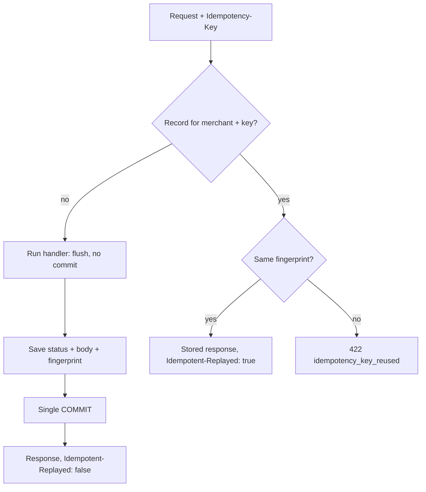

Every payment integration I have worked on in Bangladesh has had the same incident at least once. A customer on a weak mobile connection taps "Pay", the request reaches the server, the response doesn't make it back, and the app retries. Now there are two charges for one order and a support ticket that takes a week to close.

The standard fix is an `Idempotency-Key` header: the client generates a key for the operation, sends it with every retry, and the server makes sure the operation happens once. It sounds like a one-liner. In [fastapi-payment-gateway](https://github.com/AkibUllah/fastapi-payment-gateway), getting it right took four separate decisions, and it only works because two other parts of the design, a strict state machine and integer money, are in place too.

## The contract

`POST /v1/payments`, `/capture` and `/refund` accept `Idempotency-Key`. The rules are:

1. The first request with a key runs normally, and its status code and body are stored against `(merchant, key)`.
2. A later request with the same key **and the same body** gets the stored response back byte for byte, with `Idempotent-Replayed: true`. Nothing runs again.
3. A later request with the same key and a **different body** is rejected with `422 idempotency_key_reused`.
4. Keys are scoped per merchant, and records expire after 24 hours (`gateway purge-idempotency` removes them).



## Decision 1: fingerprint the operation, not just the body

The fingerprint is a SHA-256 of canonical JSON, with sorted keys and no whitespace, so `{"a":1,"b":2}` and `{"b":2,"a":1}` count as the same request. What gets hashed is not the raw body, though:

`app/api/payments.py` ([source](https://github.com/AkibUllah/fastapi-payment-gateway/blob/main/app/api/payments.py))
{: .file }

```python
request_payload={"op": "refund", "payment_id": payment_id, **body.model_dump()},
```

The operation name and the path parameter are part of the fingerprint. Without them, a client that reused the key `retry-1` for a refund on payment A and then on payment B would get A's refund receipt back for B. That's a silent wrong answer, the worst kind. With the payment ID in the hash, the second call is a mismatch, and the client hears about its bug immediately.

## Decision 2: a mismatch is an error, not a replay

Some implementations return the stored response whenever the key matches, whatever the body says. I think that hides real bugs. If a client sends `amount_minor: 150000` and then `amount_minor: 999` under the same key, something is wrong on its side: a reused counter, a key derived from the wrong field, a cache bug. Returning the first response would tell it the ৳9.99 payment succeeded when it never happened.

The status code is a deliberate choice too. `409` already means `invalid_transition` in this API (for example, capturing a refunded payment). Using `422` for key reuse lets a client tell "you sent me a contradictory request" apart from "the payment is in the wrong state" by status code alone. The test is plain:

`tests/test_idempotency.py` ([source](https://github.com/AkibUllah/fastapi-payment-gateway/blob/main/tests/test_idempotency.py))
{: .file }

```python
conflict = client.post(
    "/v1/payments",
    json={"amount_minor": 999, "currency": "BDT", "method": "bkash"},
    headers=headers,
)
assert conflict.status_code == 422
assert conflict.json()["error"]["code"] == "idempotency_key_reused"
```

## Decision 3: the receipt and the charge commit together

This is the part that most often goes wrong. If the payment is committed first and the idempotency record second, a crash between the two leaves a charge with no receipt, and the client's retry creates a second charge. If the record goes first, a crash leaves a receipt for a charge that never happened.

The helper that wraps every mutating handler solves this by owning the commit:

`app/api/idempotent.py` ([source](https://github.com/AkibUllah/fastapi-payment-gateway/blob/main/app/api/idempotent.py))
{: .file }

```python
request_hash = fingerprint(request_payload)
record = store.lookup(merchant.id, key, request_hash)
if record is not None:
    return JSONResponse(
        json.loads(record.response_body),
        status_code=record.status_code,
        headers={REPLAY_HEADER: "true"},
    )
status_code, body = produce()
store.save(merchant.id, key, request_hash, status_code, body)
db.commit()
```

`produce` is only allowed to flush, never to commit. The payment row, its `PaymentEvent` history, the queued merchant webhook and the idempotency record all go into one transaction, so either all of them exist or none do.

A consequence I like: only *returned* responses are stored. If the handler raises (a validation error, a provider timeout, an invalid transition), the session is rolled back and no record is written, so the client can retry with the same key. A provider *decline* is different. It is a successful API call that describes a failed payment (`201` with `status: failed`), so it is stored, and retrying with the same key returns the same decline. A new attempt needs a new key, which is the behaviour you want at a checkout.

## Decision 4: idempotency needs a state machine behind it

Idempotency keys protect against *retries*. They don't protect against a client sending two different, valid-looking requests, such as a capture with a new key for a payment that is already captured. That is the state machine's job.

`app/core/state_machine.py` ([source](https://github.com/AkibUllah/fastapi-payment-gateway/blob/main/app/core/state_machine.py))
{: .file }

```python
PaymentStatus.CREATED: frozenset(
    {
        PaymentStatus.AUTHORIZED,
        PaymentStatus.CAPTURED,  # auto-capture providers settle in one step
        PaymentStatus.FAILED,
        PaymentStatus.CANCELLED,
    }
),
PaymentStatus.AUTHORIZED: frozenset(
    {PaymentStatus.CAPTURED, PaymentStatus.FAILED, PaymentStatus.CANCELLED}
),
PaymentStatus.CAPTURED: frozenset({PaymentStatus.PARTIALLY_REFUNDED, PaymentStatus.REFUNDED}),
PaymentStatus.PARTIALLY_REFUNDED: frozenset(
    {PaymentStatus.PARTIALLY_REFUNDED, PaymentStatus.REFUNDED}
),
```

The table matters less than the rule that comes with it: there is exactly one way to change a status, `PaymentService._transition`. It checks the table, stamps `authorized_at` / `captured_at`, appends a `PaymentEvent` and queues the merchant webhook. An illegal move raises before anything is written and becomes a `409`. Inbound provider webhooks go through the same method, so a late "authorized" notification can't drag a refunded payment backwards. The tests cover every legal and illegal pair.

Note the self-loop on `PARTIALLY_REFUNDED`. A second partial refund is a real transition with its own event and webhook, and the refund code calls `refund_target_status` to decide whether the payment lands in `PARTIALLY_REFUNDED` or `REFUNDED`, based on the refunded total.

## Money is an integer

The last piece is what makes "same body" a reliable comparison and keeps refund maths exact: every amount is an integer in minor units. `150000` is ৳1,500.00. Floats never touch money. `Decimal` only appears when converting at the edges and when rounding fees:

`app/core/money.py` ([source](https://github.com/AkibUllah/fastapi-payment-gateway/blob/main/app/core/money.py))
{: .file }

```python
def round_half_up_div(numerator: int, denominator: int) -> int:
    quotient = (Decimal(numerator) / Decimal(denominator)).quantize(
        Decimal(1), rounding=ROUND_HALF_UP
    )
    return int(quotient)


def percentage_of(amount_minor: int, basis_points: int) -> int:
    return round_half_up_div(amount_minor * basis_points, BASIS_POINTS)
```

The sandbox bKash rule is 185 basis points, so ৳1,500.00 costs exactly 2,775 paisa. A ৳1.50 test charge works out to 2.775 paisa, which has to become 3, not 2, and not `2.7749999` because of binary floating point. SSLCommerz's rule adds a ৳2 minimum fee (`min_fee_minor=200`). Stripe's adds a fixed 30 cents. bKash and SSLCommerz notifications carry decimal strings such as `"1500.00"`. The adapters convert them with `decimal_to_minor`, which rejects anything more precise than the currency allows, so `"10.005"` BDT is an error rather than a rounding decision nobody made on purpose. Refunds are bounded by `refundable_minor = amount_minor - refunded_minor`, which is integer subtraction and can't drift.

## Where this stops

One gap is worth stating plainly. The lookup and the save happen in the same transaction, but nothing reserves the key *while* a request is in flight. If two requests with the same new key arrive at the same moment, both miss the lookup and both call the provider. The unique constraint on `(merchant_id, key)` means only one of them can commit, and the other fails. So the database ends up with one payment, but the sandbox provider was called twice. A real provider would need its own idempotency reference, or the gateway would need to insert a "processing" record before calling out. For retries after a lost response, which are what actually happens on mobile networks, the current design is correct. Simultaneous duplicates from a double-submit need that extra step.

> **Update, 26 October 2026:** that extra step is now in place ([PR #13](https://github.com/AkibUllah/fastapi-payment-gateway/pull/13), released in [v0.2.0](https://github.com/AkibUllah/fastapi-payment-gateway/releases/tag/v0.2.0)). A request first inserts an `in_progress` reservation for its key and commits it, so the unique constraint picks one winner before any provider call. A duplicate that arrives meanwhile gets `409 idempotency_key_in_progress` with `Retry-After`. A failed request releases the key, and a crashed one frees it when a short lease expires. A new CI job races eight concurrent requests for one key on PostgreSQL and checks that exactly one reserves it.

## What I'd do next

From the repository's roadmap:

- **Alembic migrations.** The schema, including the `uq_idempotency_merchant_key` constraint that the design depends on, is created with `create_all` today.
- **Durable webhook retry with backoff.** Merchant webhooks currently get a few attempts inside a background task. The outbox rows are already there, so the next step is handing them to something like my [webhook-relay](https://github.com/AkibUllah/webhook-relay) project.
- **Real HTTP adapters** for bKash tokenized checkout and SSLCommerz behind the existing `PaymentProvider` protocol, with recorded fixtures. That is also where provider-side idempotency references would be wired in.
- **Settlement adjustments** for refunds that happen after a batch has been generated.
- **Per-merchant fee contracts** loaded from configuration instead of the static fee table.
