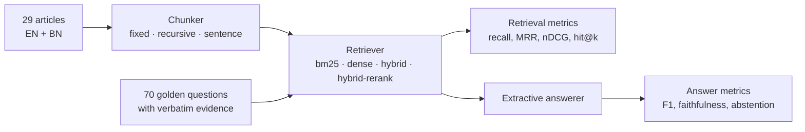

Most retrieval-augmented generation demos I review are tuned by trying three questions and looking at the answers. In fintech support that isn't good enough. A wrong cash-out fee or an invented dispute deadline is a compliance problem, not a cosmetic one. I built [rag-eval-lab](https://github.com/AkibUllah/rag-eval-lab) to treat retrieval as something you measure first and tune second.

The setup is a help centre for a fictional Bangladeshi mobile wallet, Shapla Pay: 29 articles, 24 in English and 5 in Bangla. Next to it is a golden set of 70 questions: 55 English and 11 Bangla questions that can be answered from the articles, plus 4 that deliberately can't. One command, `rag-eval compare`, scores every combination of chunker and retriever. Everything runs offline, with no API keys.



## Making the comparison fair: evidence spans, not chunk IDs

The obvious way to label a golden set is "the answer is in chunk 7". That breaks the moment you change the chunker, because chunk 7 no longer exists. Each chunker would need its own labels, and comparing chunkers would mean comparing labelling effort.

Instead, every golden item stores the *verbatim evidence passage* from the source document. Loading the set resolves each passage to a character span, and every chunker records the character span of each chunk. Relevance is then plain arithmetic:

`rag_eval_lab/evaluation/dataset.py` ([source](https://github.com/AkibUllah/rag-eval-lab/blob/main/rag_eval_lab/evaluation/dataset.py))
{: .file }

```python
def covers(chunk: Chunk, ev: Evidence, min_coverage: float = MIN_COVERAGE) -> bool:
    if chunk.doc_id != ev.doc or ev.end <= ev.start:
        return False
    overlap = min(chunk.end, ev.end) - max(chunk.start, ev.start)
    return overlap > 0 and overlap / (ev.end - ev.start) >= min_coverage
```

A chunk is relevant if it covers at least half of an evidence passage. One golden set now scores 80-word windows, heading-aware sections and single sentences on the same terms. A test checks that every evidence passage resolves, so a typo in the golden file fails CI instead of quietly lowering recall.

The second rule is that **metrics count passages once**. Fixed windows overlap by 20 words, so two neighbouring chunks often contain the same evidence. If both counted, overlapping chunkers would get a free boost in recall and nDCG. In this harness a chunk only adds gain if it covers a passage that no higher-ranked chunk has covered yet.

## The results

These are selected columns from the README's comparison table (`k=5`, offline answerer). The full table, with Hit@5, citation precision and faithfulness, is in the repository.

| Chunker | Retriever | Chunks | Recall@5 | MRR | nDCG@5 | Hit@1 | Answer F1 | Abstain acc | Ctx words | p50 ms |
|---|---|---:|---:|---:|---:|---:|---:|---:|---:|---:|
| fixed | bm25 | 73 | 0.992 | 0.875 | 0.889 | 0.788 | 0.386 | 0.500 | 327 | 0.08 |
| fixed | dense | 73 | 1.000 | 0.860 | 0.881 | 0.758 | 0.378 | 0.250 | 337 | 0.58 |
| fixed | hybrid | 73 | 0.992 | 0.877 | 0.891 | 0.788 | 0.384 | 0.250 | 336 | 1.33 |
| fixed | hybrid-rerank | 73 | 0.977 | 0.854 | 0.870 | 0.742 | 0.377 | 0.250 | 339 | 4.66 |
| recursive | bm25 | 127 | 0.985 | 0.893 | 0.898 | 0.818 | 0.412 | 0.500 | 154 | 0.10 |
| recursive | dense | 127 | 0.985 | 0.853 | 0.869 | 0.758 | 0.400 | 0.500 | 156 | 0.64 |
| recursive | hybrid | 127 | 0.985 | 0.893 | 0.898 | 0.818 | 0.407 | 0.500 | 158 | 1.22 |
| recursive | hybrid-rerank | 127 | 0.985 | 0.893 | 0.897 | 0.818 | 0.414 | 0.500 | 163 | 3.24 |
| sentence | bm25 | 284 | 0.924 | 0.879 | 0.877 | 0.848 | 0.400 | 0.500 | 132 | 0.12 |
| sentence | dense | 284 | 0.939 | 0.856 | 0.864 | 0.803 | 0.395 | 0.500 | 133 | 0.95 |
| sentence | hybrid | 284 | 0.939 | 0.867 | 0.872 | 0.818 | 0.397 | 0.500 | 132 | 1.63 |
| sentence | hybrid-rerank | 284 | 0.939 | 0.867 | 0.873 | 0.818 | 0.398 | 0.500 | 134 | 2.92 |

MRR by question type for the recursive chunker:

| Retriever | Lexical (36) | Paraphrase (17) | Bangla (11) |
|---|---:|---:|---:|
| bm25 | 0.951 | 0.806 | 0.909 |
| dense | 0.905 | 0.788 | 0.848 |
| hybrid | 0.951 | 0.806 | 0.909 |
| hybrid-rerank | 0.924 | 0.835 | 0.955 |

## What I take from it

**Chunking mattered more than the retriever.** Recursive chunking (heading, then paragraph, then sentence, never crossing a section) reaches the same recall as fixed windows while handing the generator less than half the context: 154 words for five chunks against 327. With an LLM generator, those are the tokens you pay for on every question. Sentence windows get the best Hit@1 (0.848), because one sentence is a very precise target, but recall drops to 0.92–0.94 when evidence spans several sentences or a list.

**BM25 is hard to beat on a small help centre with consistent wording.** On recursive chunks, hybrid retrieval simply ties BM25. That is not a verdict on dense retrieval in general. My dense retriever uses hashed word-bigram and character-n-gram TF-IDF vectors (numpy only), which are not semantic. They help with inflected forms, which is why dense is the only retriever with perfect recall on fixed windows, and they don't help with synonyms.

**The reranker trades exact-wording precision for paraphrase and Bangla.** Overall MRR is the same as BM25 (0.893). It is better on paraphrased questions (0.835 against 0.806) and Bangla (0.955 against 0.909), and worse on questions that reuse the article's own wording (0.924 against 0.951). It costs about 30 times the latency, which is still around 3 ms. Real support questions are mostly paraphrased, so `recursive` + `hybrid-rerank` is what the API serves by default. The table says why, instead of me saying "hybrid is better".

**Answer quality is limited by the generator, not retrieval.** Evidence is in the top five for 98.5% of questions, but token F1 against the reference answers is about 0.41. The extractive answerer quotes whole sentences, and on questions that need two facts it often picks one. Faithfulness is 1.0 in every row *by construction*, because the answerer only quotes. That column is there for when an LLM generator is plugged in.

## The Bangla part

Bangla needs its own handling before any of this works. Vowel signs such as `া` and `ি`, and the hasanta, are Unicode combining marks, so a tokenizer built on plain `\w` splits `টাকা` (taka) into pieces. The tokenizer matches an explicit Bengali code-point range instead, and folds digits before anything else:

`rag_eval_lab/text.py` ([source](https://github.com/AkibUllah/rag-eval-lab/blob/main/rag_eval_lab/text.py))
{: .file }

```python
BANGLA_DIGITS = str.maketrans("০১২৩৪৫৬৭৮৯", "0123456789")
# A token is a run of ASCII letters/digits or Bengali-block code points (letters, vowel
# signs, hasanta, nukta), excluding the currency signs ৲/৳. Digit-group separators are
# removed beforehand, for both 25,000 and the South Asian 1,00,000 grouping.
_TOKEN_RE = re.compile(r"[a-z0-9]+|[ঀ-ৱ৴-৿]+")
_NUM_SEP_RE = re.compile(r"(?<=\d),(?=\d{2,3}\b)")
```

So `৩০,০০০` in an article and `30000` in a question become the same term. A light suffix stripper removes common inflections (`-এর`, `-কে`, `-টি`, `-গুলো`), and only when at least two code points of stem remain. Sentences also split on the danda `।`, which matters for the sentence-window chunker. The served pipeline answers `দিনে কতবার ক্যাশ আউট করা যায়?` ("how many times a day can I cash out?") by quoting the limit sentence from the Bangla cash-out article, with the citation `[bn-cash-out#2]`.

The same tokenizer is ported to JavaScript for the GitHub Pages demo, which runs BM25 and the answerer in the browser. Rather than trusting the port, parity tests run the JS tokenizer over the whole corpus and check that the browser pipeline returns the same top-five chunk IDs and answers as Python for all 70 questions.

## Where not to trust these numbers

- **The abstention threshold was tuned on the test set.** At `min_coverage=0.4` the answerer answers 90.9% of answerable questions and abstains on 2 of the 4 unanswerable ones. At 0.45 that becomes 87.9% and 3 of 4. I chose 0.4 on these same 70 questions, and with only four unanswerable items, "abstain accuracy 0.500" means two questions. Treat it as a starting point, not a tuned value.
- **I wrote both the corpus and the questions.** Wording overlap is probably higher than with real customer messages, which flatters BM25. The paraphrase slice is there to push against that, but it has 17 questions.
- **Small slices move in big steps.** On the 11-question Bangla slice, one question moving one rank changes MRR by several hundredths.
- **The one miss is a vocabulary gap.** `q053` asks who to contact if support didn't solve a complaint. The evidence mentions the "Grievance Redressal Officer", and the question never says "grievance" or "escalate", so every retriever returns the general customer-support page. No amount of chunking fixes that.

## What I'd do next

The roadmap in the repository follows directly from those caveats:

- **Query expansion** (synonyms, multi-query), measured on the paraphrase slice and starting with the `q053` miss.
- **A held-out split** of the golden set, so thresholds are tuned on one part and reported on the other.
- **A cross-encoder reranker** behind the existing `Reranker` protocol, compared against the lexical one on the same table.
- **Real-embedding runs** (bge-m3 via Ollama) next to the hashed baseline in the README, to see whether "BM25 is hard to beat" survives semantic vectors.
- **A persistent BM25 index**, so the API doesn't re-index on restart.

The main lesson is about method. A question like "is hybrid retrieval better than BM25?" gets answered by a golden set, a table and a command anyone can re-run, not by opinion. The same table also shows where my served default is weaker: on questions that reuse the article's own wording.
