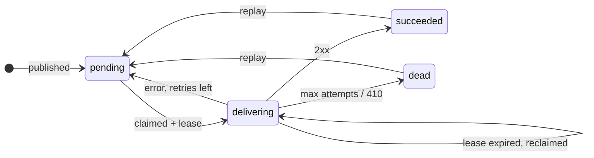

[webhook-relay](https://github.com/AkibUllah/webhook-relay) takes an event once and delivers it to every subscribed endpoint, with HMAC signatures, retries on a backoff schedule, a circuit breaker per endpoint and a dead-letter list. Until [PR #1](https://github.com/AkibUllah/webhook-relay/pull/1) it had one quiet assumption built in: only one worker was running.

The claim step was a plain `SELECT` of due deliveries followed by a status update. With one worker that is fine. Run a second replica, and both can read the same rows before either writes, so the merchant gets the same `payment.captured` twice. And if a worker died between claiming a row and recording the outcome, that row stayed in `delivering` forever, because nothing ever looked at it again.

This post covers how I fixed both problems, and how I proved the fix with a test rather than a feeling.

## Deliveries are rows, not tasks

The design decision everything else rests on: a delivery is a row in the `deliveries` table, written in the same transaction as the event. Once the API returns `201`, the notification cannot be lost. The worker is a loop that asks the database what is due. There is no broker, so there is no second source of truth to keep in sync.

That makes the database the coordination point, which is exactly what PostgreSQL row locks are good at. Here is the lifecycle after the change:



## The claim query

All the claiming happens in one statement:

`webhook_relay/services/dispatcher.py` ([source](https://github.com/AkibUllah/webhook-relay/blob/main/webhook_relay/services/dispatcher.py))
{: .file }

```python
due = and_(Delivery.status == "pending", Delivery.next_attempt_at <= now)
abandoned = and_(Delivery.status == "delivering", Delivery.claimed_until < now)
return (
    select(Delivery)
    .join(Endpoint, Delivery.endpoint_id == Endpoint.id)
    .options(selectinload(Delivery.event), selectinload(Delivery.endpoint))
    .where(or_(due, abandoned), Endpoint.is_active.is_(True))
    .order_by(Delivery.next_attempt_at)
    .limit(self.settings.batch_size)
    .with_for_update(skip_locked=True, of=Delivery)
)
```

On PostgreSQL this becomes `SELECT ... FOR UPDATE OF deliveries SKIP LOCKED`. Three details matter.

**`SKIP LOCKED`, not plain `FOR UPDATE`.** A plain row lock would make the second worker wait for the first one's transaction to finish, and then it would get the same rows. Workers would line up behind each other instead of working in parallel. With `SKIP LOCKED`, the second worker simply doesn't see rows another transaction holds, and takes the next batch.

**`OF deliveries`.** The query joins `endpoints` to filter out inactive ones. Without `OF`, PostgreSQL locks the matching endpoint rows too. Combine that with `SKIP LOCKED` and you get a strange failure: once one worker holds a busy merchant's endpoint row, every other worker skips *all* of that merchant's deliveries. A single hot endpoint would end up handled by one worker at a time. Locking only the delivery rows avoids that.

**The `abandoned` branch.** A row stuck in `delivering` is due again once its lease has expired. That one `or_` is the whole crash-recovery mechanism.

On SQLite, which the unit tests and local dev use, SQLAlchemy leaves the locking clause out. SQLite serialises writers anyway, and the status and lease checks keep a single process consistent.

## Lock briefly, send outside the lock

The obvious version holds the row locks while sending the HTTP requests. I didn't do that. A batch is up to 50 deliveries (`BATCH_SIZE`), each request can take up to `HTTP_TIMEOUT_SECONDS` (10 by default), and the worker sends them one after another. Holding a transaction open across all of that means minutes of idle-in-transaction connections and long-held locks.

Instead, the lock only protects the moment of claiming. The worker marks each row `delivering`, writes who owns it and until when, and commits straight away:

`webhook_relay/services/dispatcher.py` ([source](https://github.com/AkibUllah/webhook-relay/blob/main/webhook_relay/services/dispatcher.py))
{: .file }

```python
if delivery.status == "delivering":
    # The previous owner's lease ran out before it recorded an outcome. The send
    # may or may not have happened, so this is a redelivery (at-least-once).
    self.stats.reclaimed += 1
    logger.warning("reclaiming %s from %s (lease expired %s)", ...)
delivery.status = "delivering"
delivery.claimed_by = self.settings.worker_id
delivery.claimed_until = now + lease
claimed.append(delivery)
...
db.commit()
```

After that commit, the row lock is gone. What keeps other workers away during the send is the row's state: it is `delivering` with a lease in the future, so it matches neither branch of the claim query. Each outcome (success, retry, dead letter) clears `claimed_by` and `claimed_until` and is committed per delivery, so a crash halfway through a batch loses at most the one in-flight delivery.

## Choosing the lease length

The lease is a guess about how long a healthy worker might need, and getting it wrong in either direction costs something.

- **Too short:** a slow but healthy worker loses its rows to another worker while it is still sending. That causes exactly the duplicates the change was meant to prevent.
- **Too long:** after a real crash, deliveries sit there until the lease runs out.

The default leans toward correctness. `CLAIM_LEASE_SECONDS` defaults to `BATCH_SIZE × HTTP_TIMEOUT_SECONDS + 60`, which is 560 seconds with the defaults. That is long enough for every request in a full batch to time out, plus some margin. If you want faster recovery, lower the batch size or the timeout; the lease follows automatically. `WORKER_ID` defaults to `<hostname>-<pid>` and is stored as `claimed_by`, so the API can show which pod holds a delivery, and `/metrics` counts reclaimed rows.

## At-least-once, stated honestly

This design doesn't give exactly-once delivery, and no webhook system can without help from the receiver. One window always remains: the worker sends, the receiver processes the request and returns `200`, and the worker dies before committing the outcome. When the lease expires, another worker sends the event again.

So the contract is at-least-once, and the receiver gets what it needs to deduplicate: every request carries `X-Relay-Event-Id` and `X-Relay-Delivery-Id`, and the signature covers a timestamp so an old request can't be replayed later. What `SKIP LOCKED` and leases remove is the *avoidable* duplicate, where two healthy workers send the same row at the same time. They also make sure a crash leads to a resend rather than a row that is silently stuck.

## The test that proves it

Concurrency fixes are easy to believe and hard to test. The tempting version, starting two dispatchers on one event loop, doesn't test the lock at all. Each `run_once` claims and commits before the other one runs, so the status column alone keeps them apart.

The test that does exercise the lock holds a transaction open on purpose:

`tests/test_claiming.py` ([source](https://github.com/AkibUllah/webhook-relay/blob/main/tests/test_claiming.py))
{: .file }

```python
# Worker A selects and locks its batch but has not committed yet ...
tx_a = sessions()
rows_a = list(tx_a.scalars(a.claim_statement(T0)).all())
# ... meanwhile worker B claims: locked rows are skipped, not waited on or duplicated.
with sessions() as tx_b:
    claimed_b = b._claim_due(tx_b, T0)
ids_a = {d.id for d in rows_a}
ids_b = {d.id for d in claimed_b}
tx_a.rollback()
tx_a.close()

assert len(ids_a) == 5
assert len(ids_b) == 3
assert ids_a.isdisjoint(ids_b)
```

Eight deliveries are seeded with a batch size of 5. Worker A locks five and doesn't commit, which is the exact moment two replicas would collide. Worker B has to come back with the other three. I checked that the test can fail: with the lock removed, B claims the same five rows A is holding and the `isdisjoint` assertion fails. A concurrency test that has never been seen failing doesn't prove much.

A second PostgreSQL test runs two workers against ten events and asserts each event ID reached the mock receiver exactly once. To be clear about what it covers: it interleaves the workers rather than racing them, so it really checks the claim, lease and release bookkeeping across workers, not the lock. The first test is the one about the lock.

Crash recovery runs on SQLite with an injected clock. A dispatcher called `dead-pod` claims a row and is then dropped. A healthy worker gets nothing while the lease is live, and after `clock.advance(seconds=61)` it reclaims the row, delivers it and records `reclaimed == 1`. There's no sleeping in the test; the clock is a parameter.

The PostgreSQL tests are skipped unless `TEST_DATABASE_URL` is set. CI runs them in their own job, `claiming on PostgreSQL`, against a `postgres:16-alpine` service, so the lock behaviour is checked on every push without making local test runs depend on a database.

## What this doesn't cover yet

- **Breaker counters are approximate across workers.** The circuit breaker state lives on the endpoint row, which the claim deliberately doesn't lock. Two workers recording failures for the same endpoint at the same time can overwrite each other's `consecutive_failures`. The breaker still opens, just maybe a failure or two later. I accepted that rather than serialise every endpoint again.
- **Sends within a batch are sequential.** Parallelism comes from running more workers, not from concurrency inside one worker. This keeps the lease arithmetic simple and honest.
- **Existing databases need two columns.** Tables are created with `create_all`, which doesn't alter existing tables, so the README has the `ALTER TABLE` statements for upgrading.

## What I'd do next

These come from the repository's roadmap, and several connect directly to this change:

- **Per-endpoint rate limiting and concurrency caps.** Once several workers can send to the same merchant at the same time, a cap per endpoint is the natural partner to the breaker. It would also be a good place to make the breaker counters exact.
- **Alembic migrations.** The upgrade SQL in the README is really a migration written by hand. It should be versioned and applied automatically.
- **A retention job** that archives old succeeded deliveries and attempts, so the indexes the claim query uses on `status` and `next_attempt_at` stay small as the history grows.
- **OpenTelemetry spans around each attempt**, so a delivery can be traced from publish, through claiming and reclaiming, to the receiver's response.

The whole change is in [PR #1](https://github.com/AkibUllah/webhook-relay/pull/1): 57 changed lines in the dispatcher, a PostgreSQL CI job, and a test file nearly four times that size.
